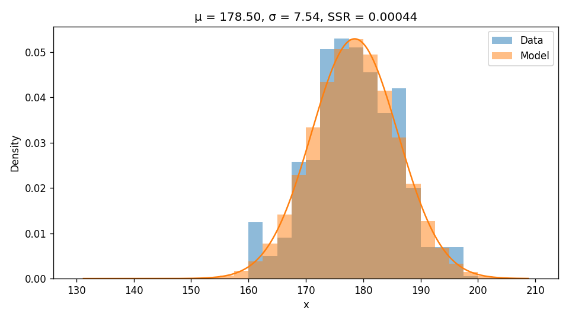
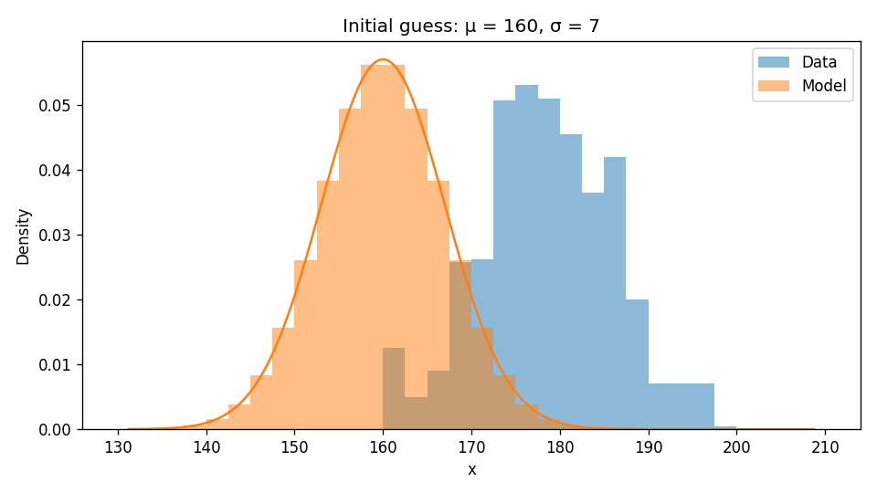
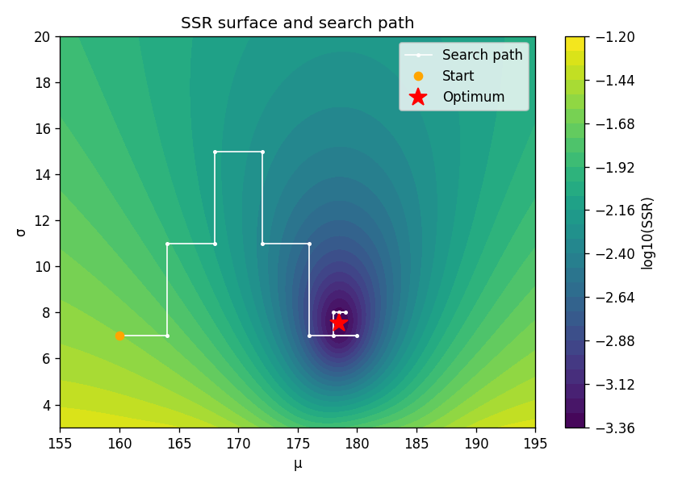
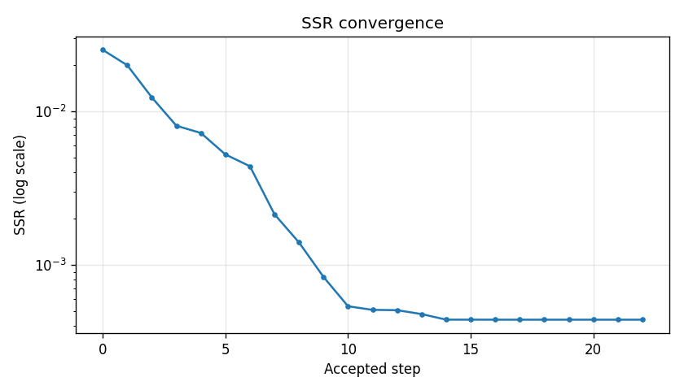

# Fitting a normal distribution to a histogram

This project estimates the mean **μ** and standard deviation **σ** of a normal distribution so that its curve matches a given histogram as closely as possible. It doesn't use an optimisation library. Everything is NumPy plus a small hand-written search.



## How it works

**Model.** The normal probability density:

$$
g(x \mid \mu, \sigma) = \frac{1}{\sigma\sqrt{2\pi}} \exp\left(-\frac{(x-\mu)^2}{2\sigma^2}\right)
$$

**Loss.** The gap between the observed densities $f_i$ and the model $g(x_i)$ at each bin centre, measured as the sum of squared residuals (SSR):

$$
\text{SSR}(\mu, \sigma) = \sum_i \big(f_i - g(x_i \mid \mu, \sigma)\big)^2
$$

**Search.** A coordinate-wise pattern search:

1. Start at μ = 160, σ = 7 with a step of 4.
2. Try moving μ or σ by ±step. Keep the move if SSR drops.
3. If no direction helps, halve the step.
4. Stop once the step is below 10⁻⁴.

## Data

32 bins of width 2.5 over [130, 210]. The 16 observed density values start at the 160 bin, and every other bin is 0.

## Results

| Parameter | Value |
|---|---|
| μ | **178.50** |
| σ | **7.54** |
| SSR | 0.000440 |
| Accepted steps | 22 |

### Before and after

| Initial guess (μ = 160, σ = 7) | After fitting |
|---|---|
|  |  |

### SSR surface and search path

The SSR surface has a single clear minimum. The white line shows the steps the search took: big zig-zag moves along one axis at a time at first, then smaller and smaller steps around the optimum.



### Convergence

SSR drops about 57 times (from 0.0252 to 0.00044) within roughly 14 accepted steps. After that it barely moves, because the step size is already tiny.



## Running it

```bash
git clone https://github.com/MinhHieu15/gauss-normal-fit.git
cd gauss-normal-fit
pip install -r requirements.txt
python gauss_fit.py
```

Add `--no-show` to save the figures to `figures/` without opening any windows.

## Layout

```
gauss-normal-fit/
├── gauss_fit.py      # main script
├── Gauss.ipynb       # original notebook
├── figures/          # figures generated by gauss_fit.py
├── requirements.txt
└── README.md
```

## Limitations and next steps

- Pattern search only guarantees a local minimum. The SSR surface here is well behaved, so that isn't a problem, but a harder model would need several starting points.
- Compare against `scipy.optimize.curve_fit` or a maximum likelihood estimate.
- Extend it to a mixture of several Gaussians.
